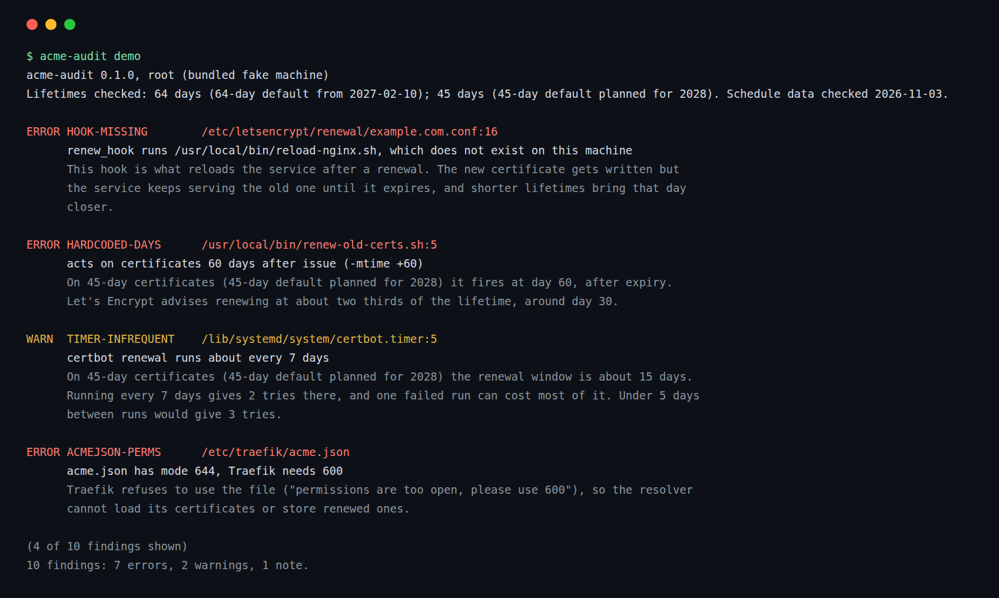

# acme-audit

[](https://github.com/kd-011/acme-audit/actions/workflows/ci.yml)

acme-audit reads the files that decide how a machine renews its Let's Encrypt certificates and says which ones will stop working when lifetimes get shorter. It looks at certbot, acme.sh, lego, Caddy, Traefik, systemd timers, cron and the wrapper scripts in between. It only reads. It does not run certbot, open a network connection or write a file.



## Why

On 2026-10-07 Let's Encrypt announced that from 2027-02-10 its default certificate lifetime is 64 days, down from 90, and that 45 days is planned for 2028. Its post says that if your renewals are hard-coded to a number of days you should change them to renew at about two thirds of the lifetime, and it suggests grepping cron jobs, wrapper scripts and runbooks for 83, 80 or 60. acme-audit does that grep for you, and checks the other things that tend to break at the same time: hooks that no longer run, timers that fire too rarely, client settings that pin an old window. The sources and the dates I read them on are in [docs/background.md](docs/background.md).

## Try it

Needs Node 22 or newer. Nothing is installed or configured:

```sh
npx github:kd-011/acme-audit demo
```

It builds a fake machine in a temp dir, with certbot, acme.sh, lego, Caddy and Traefik files that each get something wrong, audits it, prints the findings, deletes the temp dir and exits 1.

## Install

```sh
npm install -g github:kd-011/acme-audit
acme-audit --version
```

It is not on the npm registry. There are no dependencies. I develop and test it on Linux.

## Use it on a machine

```sh
sudo acme-audit              # audit /
acme-audit --root /mnt/old-server   # audit a mounted copy or a backup
acme-audit --json            # for scripts, schema in docs/json-schema.md
```

Run it as root if you want it to see root's crontab and root's home directory. When it cannot read something it says so once and carries on.

Exit codes: 0 nothing found, 1 findings, 2 the tool could not run. `--fail-on error` makes warnings and notes exit 0.

## What it reads

- certbot: `/etc/letsencrypt/renewal/*.conf` (renew_before_expiry, authenticator, the pre, post and deploy hooks, webroot paths) and `/etc/letsencrypt/renewal-hooks/*`.
- acme.sh: the domain conf files under `~/.acme.sh` (Le_RenewalDays, the hooks and the reload command) and its cron line.
- lego: any cron line, systemd service or script that runs `lego ... renew`, including `--days` and `--renew-hook`.
- Caddy: the Caddyfile and what it imports (acme_ca, renewal_window_ratio, renew_interval, issuer settings).
- Traefik: the static config (YAML or TOML), its certificatesResolvers, and the mode of each acme.json.
- systemd timers, cron files, cron.daily and the others, and any script they call or that sits in /usr/local/bin, for a hardcoded renewal threshold in days.

The full list of paths, and exactly what triggers each finding, is in [docs/reference.md](docs/reference.md).

## What it reports

| Kind | Meaning |
| --- | --- |
| HARDCODED-DAYS | A cron line, unit or script renews after a fixed number of days that does not fit the new lifetimes. |
| HOOK-MISSING | A hook points at a program that is not there. |
| HOOK-NOT-EXECUTABLE | A hook exists but has no execute bit. certbot runs only the executable files in `renewal-hooks`. |
| RENEW-WINDOW | A client setting leaves too few days to retry, or fires on every run. |
| TIMER-INFREQUENT | The thing that runs the renewal runs too rarely, is not enabled, or is not there. |
| ACMEJSON-PERMS | Traefik's acme.json is more open than 600, which Traefik refuses to use. |
| DEAD-AUTH | The renewal cannot prove control of the domain: no authenticator, a missing webroot, no challenge, or a staging CA. |
| OLD-CLIENT | certbot or acme.sh is older than the first release that asks Let's Encrypt when to renew (ARI). |

Each finding names the file and line, says what is wrong, and says why it matters for the lifetimes in [data/schedule.json](data/schedule.json). Findings are sorted errors first.

## How the numbers are chosen

Lifetimes and dates are not written into the code. They are in `data/schedule.json` with the page each came from, and a pull request can update them. The file also holds two choices of mine: a renewal needs at least 7 days of retries left, and the job that runs it needs to get at least 3 tries inside the renewal window. Both are easy to disagree with, and both can be changed in the file or tested with `--schedule` and `--lifetime`.

## What it does not do

It reads configuration. It cannot tell you that a certificate on disk is about to expire, that a hook succeeds when it runs, or that a container on another host renews anything. It does not check that your client talks ARI. [docs/limitations.md](docs/limitations.md) lists what is left out, including a risk I have not been able to measure: the demand for this comes from one announcement, and I do not know how many people will want it once the change has happened.

## Compared with other tools

`certbot renew --dry-run` tests a renewal against staging, and it skips deploy hooks unless you add `--run-deploy-hooks`. So it tests whether issuance works, and says little about whether the reload after issuance works. A monitor such as Uptime Kuma, which the [virtualizationhowto post of 2026-10-15](https://www.virtualizationhowto.com/2026/10/lets-encrypt-is-shortening-certificate-lifetimes-is-your-home-lab-ready/) recommends, watches the certificate and warns when it is close to expiry. acme-audit looks earlier, at the configuration, across the clients on one machine.

## Contributing

Bug reports, new checks and schedule updates are welcome: [CONTRIBUTING.md](CONTRIBUTING.md). MIT licence.
